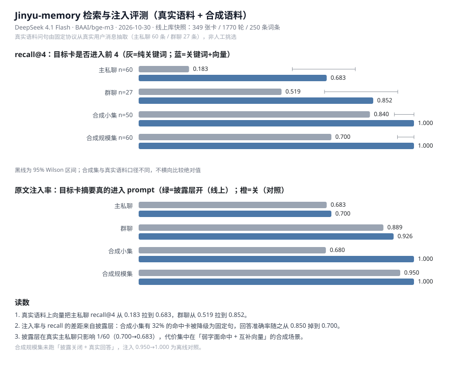
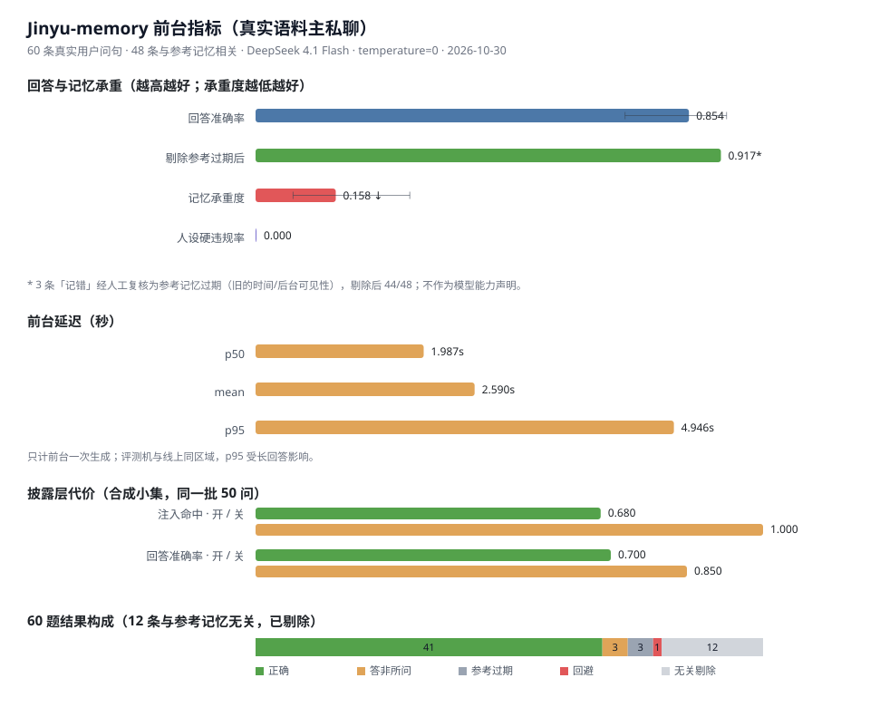

# Jinyv Memory

瑾瑜的**记忆中间层**

- 热窗口 / 事件卡 / 长期事实 / 归档游标
- 钩子召回、规则召回、冲突标注、承诺状态机
- 人设护栏、输出中间层（删动作 / 限长度 / 去 AI 味）
- 梯度记忆、压缩、保留策略、Dream 整理、会话轮换
- 框架无关：不依赖 NoneBot / OneBot / FastAPI

平台接入在独立仓库 **[Jinyv-plugins](https://github.com/YVFENGXS/Jinyv-plugins)**：

| 接入 | 仓库 |
|---|---|
| QQ（OneBot v11 / NapCat） | [Jinyv-plugins/qqbot](https://github.com/YVFENGXS/Jinyv-plugins) |
| 桌宠 | [Jinyu-pet](https://github.com/YVFENGXS/Jinyu-pet) + 插件仓适配层 |
| 视频通话 | [jinyu-video-call](https://github.com/YVFENGXS/jinyu-video-call) + 插件仓适配层 |
| 房间 / 舞台渲染 | [Jinyv-room](https://github.com/YVFENGXS/Jinyv-room) |

## 目录

```
jinyv_memory/
├── __init__.py          # 对外只暴露 JinyuHost
└── core/                # 记忆实现（零第三方依赖）
    ├── rp_skeleton.py    # 热窗口 / 事件卡 / 归档 / 检索 / 工具循环
    ├── host.py           # 框架中立宿主 JinyuHost
    ├── style_middleware.py  # 输出中间层（确定性，不靠 prompt）
    ├── persona.py        # 人设宪法层（由用户维护）
    ├── promise.py / retriever.py / summarizer.py / conflict.py
    ├── compression.py / gradient.py / retention.py / sealing.py
    ├── context_budget.py / scoring.py / control.py / disclosure.py
    ├── embedding.py / merge_ann.py / dream.py / intimacy.py
    ├── questions.py / gate.py / persona_guard.py / llm.py
    ├── ledger.py / forgetting.py / recall_shadow.py  # 文本审计 / 重要性衰减 / 召回埋点
    └── status.py / bubbles.py
tools/                   # 宿主服务、健康检查、评测、Dream、backfill
tests/                   # 核心回归 + 输出中间层回归
examples/                # 离线 demo / 命令行聊天
docs/                    # 设计、评测与实验记录
```

## 快速开始（离线，不需要密钥）

```bash
python -m pip install -r requirements.txt   # core 零依赖，等价于什么都不装
python examples/demo.py
python tests/test_regression.py
python tests/test_style_middleware.py
```

## 同进程宿主

```python
from jinyv_memory import JinyuHost

host = JinyuHost(db_path="data/rp_memory.db", sid="main")
print(host.chat("今天看到一条蓝色大肥鱼"))   # 写入一轮并生成回复
host.remember("主人喜欢蓝色", speaker="主人")  # 直接写长期词条
print(host.recall("蓝色"))                   # {"facts": [...], "cards": [...]}
host.close()                                # 冲刷尾部归档
```

`host.close()` 必须调用，否则退出时尾部归档可能丢。

## 跨进程宿主（HTTP）

```bash
export RP_HOST_TOKEN=<随机串>
export RP_FRONT_KEY=sk-... RP_BACK_KEY=sk-...
python tools/serve.py --port 8710 --db data/rp_memory.db
```

| 接口 | 作用 |
|---|---|
| `GET /health` | 存活检查（不校验令牌） |
| `POST /chat` `{"text","session"}` | 写入一轮对话，返回 `{"reply","session"}` |
| `POST /remember` `{"text","speaker","session"}` | 直接写长期词条 |
| `GET /recall?q=&session=&limit=` | 只读召回 |

除 `/health` 外都要 `Authorization: Bearer <RP_HOST_TOKEN>`。
**同一个 `RP_DB` 只能有一个写入进程**，多进程会抢归档游标。
`JinyuHost` 启动时用文件锁强制这一点（同进程多会话共享计数，跨进程第二者直接报错；
确需并行设 `RP_WRITER_LOCK=0`）。

## 环境变量

核心变量见 [.env.example](.env.example)。最常用的：

| 变量 | 说明 |
|---|---|
| `RP_DB` | SQLite 记忆库路径，默认 `data/rp_memory.db` |
| `RP_FRONT_KEY` / `RP_BACK_KEY` | 前台 / 后台模型密钥 |
| `RP_MAX_TOKENS` | 前台模型上下文窗口（不是输出上限） |
| `RP_HOST_TOKEN` | HTTP 宿主服务令牌 |
| `RP_STYLE_MIDDLE` | 输出中间层开关，默认开 |
| `RP_SESSION_EPOCH_HOURS` | 闲置多少小时轮换会话，默认 48 |
| `RP_WRITER_LOCK` | 单一写入者锁，默认开；`0` 关闭 |

## 硬约束

- `archive_cursor` 只在事件卡落库成功后推进。
- 单张卡区间长度 ≤ `archive_batch`；退出冲刷才允许吃尾巴。
- 账本是权威源，后台模型只能提议，不能直接改状态。
- `core/persona.py` 是人设宪法层，由用户维护，不要自行改写。
- 头尾双锚（人设 + 当前状态账本）永不截断。

## 审计、衰减与埋点

三个独立小工具，都不改记忆语义，默认只读或只演算：

| 模块 | 作用 | 命令 |
|---|---|---|
| `ledger.py` | 每条正文记 SHA256，只增不改；删除/合并走 `retire` 留痕 | `python -m jinyv_memory.core.ledger --db data/rp_memory.db --verify` |
| `forgetting.py` | 长线记忆：默认只加固、不降低；`--decay` 才启用时间淡忘 | `python -m jinyv_memory.core.forgetting --db data/rp_memory.db --apply` |
| `recall_shadow.py` | 只记录每轮召回特征与命中数，供以后定「什么时候该查」 | `python -m jinyv_memory.core.recall_shadow --db data/rp_memory.db` |

- `ledger.retire` 记原因、被谁接管、原文片段；`/merge promises` 合并时自动调用。
- `forgetting` 默认只演算；`--apply` 前先整库备份并 `integrity_check`。
  默认是**长线记忆**：放再久也不降低，只记录被想起时的加固；
  确需淡忘时加 `--decay`（或 `RP_FORGET_DECAY=1`，单日最多掉 `0.03`，`importance >= 0.70` 不衰减）。
- `recall_shadow` 由 `add_recall_trace` 顺带写入，任何异常都吞掉，不影响回复。

## 治理层

`core/governance.py` 把「事件时间、撤回、证据、矛盾」四件事收在一处，全部是增量列/表，
老库启动时自动迁移。设计参考 QingyiPersonal 的认知账本，只保留与平台无关的部分。

| 能力 | 落点 | 规则 |
|---|---|---|
| 事件时间 | `event_cards.occurred_at`、`durable_facts.occurred_at` | 展示与排序优先用发生时间，空值回落 `created_at` |
| 类型化撤回 | `retract_kind` | `invalid_observation` / `misunderstanding` / `belief_correction` / `scope_revoke` |
| 失效传播 | `memory_invalidations`、`memory_units.invalidated_by` | 只标记不删除；同轮次记忆单元与 `supersedes` 派生行一并失效 |
| 证据分层 | `evidence_layer` | 亲历/听说/查到/推测/想象/未知；推测与想象永不 `verified` |
| 矛盾并列 | `memory_contradictions` | 直接矛盾两条都留，不自动覆盖；`(a,b)` 与 `(b,a)` 归一幂等 |

```python
import governance
governance.retract(db, "event", event_id, "misunderstanding", by="mind")
governance.record_contradiction(db, "fact", a_id, "fact", b_id, cid="c1")
governance.set_verified(db, "fact", fid)   # 非亲历/查到会返回 False
```

`list_units()` 默认过滤 `invalidated_by` 非空的单元，传 `include_invalidated=True`
可以查看留痕。

## 测试

```bash
python tests/test_regression.py        # 记忆语义全量回归
python tests/test_style_middleware.py  # 输出中间层
python tests/test_ledger_forgetting.py # 审计 / 衰减 / 召回埋点
python tests/test_governance.py        # 事件时间 / 撤回传播 / 证据闸门 / 写锁
python tools/eval_memory.py --min-recall 0.8 --min-holdout 0.7
```

Python 3.10–3.13。3.14 起标准库新增 `compression` 包，会与本仓库
`core/compression.py` 重名；在 3.14 上请用虚拟环境或把 core 目录置前。

## 评测结果（可复现，2026-10-29/30 记录）

> 以下数字来自重构前的同一套 core，评测脚本与语料仍在仓库；模块拆分不改变记忆逻辑。

两套人工标注的合成语料，同一份 GT 分别跑「关键词（默认，含别称表）」和「关键词 + bge-m3 向量」。
下表为服务器实测（bge-m3 走 SiliconFlow），区间是 Wilson 95% CI：

| 语料 | 用例 | 模式 | recall@4 | MRR |
|---|---|---|---|---|
| 小集 | 50 | 关键词（含别称表） | 0.840 [0.715, 0.917] | 0.702 |
| 小集 | 50 | + 向量 | **1.000** [0.929, 1.000] | **0.898** |
| 规模集 | 60 | 关键词（含别称表） | 0.700 [0.575, 0.801] | 0.669 |
| 规模集 | 60 | + 向量 | **1.000** [0.940, 1.000] | **0.922** |
| 真实主私聊 | 60 | 关键词（含别称表） | 0.183 [0.106, 0.299] | 0.131 |
| 真实主私聊 | 60 | + 向量 | **0.683** [0.558, 0.787] | **0.585** |
| 真实群聊 | 27 | 关键词（含别称表） | 0.519 [0.340, 0.693] | 0.444 |
| 真实群聊 | 27 | + 向量 | **0.852** [0.675, 0.941] | **0.654** |

分层看 holdout（换一种说法还能不能召回）：小集 0.784 → 1.000，规模集 0.400 → 1.000；
上表两种模式的 literal 都是 1.000（去掉别称表时小集 literal 为 0.889，见评测报告）。

披露层开启（线上默认）时，原文注入率：小集 0.680、规模集 0.950、真实主私聊 0.683、真实群聊 0.889；
关闭披露对照为 1.000 / 1.000 / 0.700 / 0.926。差距来自披露分级，不是检索失败。

> 2026-10-30 线上库增长后按同一协议重新抽样（主私聊 306 卡 / 60 问、群聊 35 卡 / 27 问），主私聊混合
> `recall@4` 0.650 [0.524, 0.758]、注入 0.700，群聊 0.852 [0.675, 0.941]、注入 0.963；P1 的逐项 A/B
> 见 [评测报告 4.2–4.3](docs/benchmark-report.md#L86)。两组问句不同，不能逐点横比。





### 前台指标（真实语料主私聊）

60 条真实用户问句（48 条与参考记忆相关），同一次运行的三联指标：

| 回答准确率 | 平均 prompt token | 延迟 p50 / p95 |
|---|---|---|
| **0.854** [0.728, 0.928] | 3852 | 1.99 s / 4.95 s |

3 条「记错」为参考记忆过期，剔除后 0.917；人设硬违规 0/60；承重度 0.158。
`python tools/eval_memory.py --real ...` 现在会直接打印这张表（token 用与线上水位线同一套本地估算）。

> **外部基准 LongMemEval-S：已接入适配脚本，但仍是「非官方口径」。** 数据集不入库；
> `tools/eval_longmemeval.py` 把每个实例按 session 切成文档、用本仓库检索选证据、前台作答、judge 判分。
> `--dry-run` 不需要任何 key（只验证证据命中），真跑需要 `RP_FRONT_KEY`（有 `RP_EMBED_KEY` 时自动开向量）。
> 官方 LongMemEval 用 GPT-4o 判分、把整段历史塞进上下文，本适配不满足这两点，
> 所以**不把它的数字当成 LongMemEval-S 官方分数**。

### 显著性（mentions / verified）

`mentions >= 3` 或 `verified >= 2` 记为 solid，同分卡再按 `mentions + verified` 排序。

| 场景 | 开 | 关（消融） |
|---|---|---|
| 六张同分卡 · 5 题 | **1.000** | 0.000 |
| 短指代 · 12 题（伞 / 茶 / 信） | **1.000** | 0.000 |

### 机制消融

| 机制 | 开 | 关 |
|---|---|---|
| 保密闸门 · 召回通道 | 泄漏 0/3 | 泄漏 3/3 |
| 保密闸门 · 热窗通道 | 泄漏 0/3 | 泄漏 3/3 |
| 承诺段 | 有段，命中 3/3 | 无段，命中 1/3 |
| 水位线 | 834 tok，命中 0.400 | 1460 tok，命中 1.000 |

外部基线（30 卡 / 60 问，1000 token 硬预算）：

| 策略 | 注入命中 | 平均 token |
|---|---|---|
| ours | **0.767** | 764 |
| 全量（截断） | 0.400 | 834 |
| 全量不裁 | 1.000 | 1460 |
| 只给最近 | 0.200 | 669 |

注意水位线一项：1000 token 下会过度裁剪（命中 1.000 → 0.400）。默认预算应按真实语料
标定，不要照搬评测里的硬预算；真实主私聊在 8000 预算下 0 丢段、命中 0.683。

### 2026-11-23 真实账号复测（1320 卡 / 6261 行）

同一套 46 条人工标注问句，在线上库（10-25 ~ 11-23）上复测：

| 通道 | recall@4 | MRR@4 |
|---|---|---|
| 纯关键词 | 0.239 | 0.185 |
| 纯向量（bge-m3） | 0.565 | — |
| 向量 + cross-encoder 重排 | 0.696 | 0.607 |
| **多路召回 + 重排 + 第二证据加权** | **0.804** | **0.643** |

- 失败集中在「向量第 5~20 名」：GT 与 top-1 的余弦只差 0.02~0.06，双塔分不开，
  换成 `bge-reranker-v2-m3` 精排后拉回 13 个百分点。
- 重排候选取「向量池 ∪ 钩子命中」，绝不能只吃 RRF 截断后的前 4：关键词命中的
  错误卡会占名额，把向量第 5~20 名的正确卡挤掉（实测 0.652 vs 0.696）。
- 完整评测（检索、回答质量、预算、冗余、账本、衰减、性能、隐私）：
  [docs/memory-eval-20261123.md](docs/memory-eval-20261123.md) ·
  [JSON 指标](docs/memory-eval-20261123.json)。
- 重排分数映射到 1.4~3.8，下限高于 `RECALL_MIN_REL`，避免语义排好的第 2~4 名
  再被字面尺度的相对闸门误杀。
- 预算低于 2600 token 时启动告警：账本 + 人设约 2.36k 不可裁，再小每轮都会丢段。

相关开关：`RP_RERANK`（默认 1，`0` 回滚）、`RP_RERANK_POOL`（默认 20）、
`RP_RERANK_TIMEOUT`（默认 4 秒，防止重排把回复拖死）、`RP_EMBED_KEY` / `RP_ASR_KEY`。

### 多路召回：摘要正文 / 词条 / 全量标签（2026-11-23）

关键词通道只匹配 `entity_hooks`，而 97.8% 的标准答案其实写在卡摘要正文里。
新增三路词法候选，全部并入重排池，不直接决定注入顺序：

| 通道 | 作用 | recall@4（单独） |
|---|---|---|
| 摘要正文 BM25 | 「养的猫叫团子」这类事实句本身变成索引 | **0.652** |
| 词条 BM25 | 长期词条按 `turn_end` 映射回事件卡（结论层） | 0.391 |
| 全量标签倒排 | 2109+ 标签按 IDF 匹配，长尾标签也能被问到 | 0.152 |

- 候选并集（重排池）覆盖率：**0.935**（`vec 20 ∪ 摘要 20 ∪ 词条 15 ∪ 标签 20`，重排截断 60），
  比只吃向量+钩子的 0.696 多出可救回的 GT。
- 最终 46 题实测：**recall@4 = 0.804**、MRR 0.643（字面 0.846 / 换说法 0.750）。
  其中重排候选扩容贡献 +0.044，摘要/词条「第二证据」加权再贡献 +0.043。
- 无 embedding 的降级路径（纯词法加权）recall@4 = **0.674**、MRR 0.491，
  其中换说法（para）从 0.200 升到 **0.850**。
- 三路一起算的固定开销约 **25 ms/轮**（1320 卡），远小于组 prompt 的 456 ms。
- 后台联想的标签表不再截断到 top 60：改为「全量标签按问句相关性排序 + 高频补满」
  （`RP_ASSOC_TAG_MAX` 默认 120），长尾标签第一次真正进入后台可见范围。

相关开关：`RP_SUMMARY_RECALL` / `RP_SUMMARY_LIMIT`（默认 20）、
`RP_FACT_RECALL` / `RP_FACT_RECALL_LIMIT`（默认 15）、
`RP_TAG_RECALL` / `RP_TAG_LIMIT`（默认 20）、
`RP_RERANK_BOOST_SUM` / `RP_RERANK_BOOST_FACT`（默认 0.35 / 0.15，设 0 关闭二次加权）。

### 复现

```bash
python tests/test_regression.py                        # 记忆语义全量回归
python examples/demo.py                                 # 离线演示断言
python tools/eval_memory.py --corpus small --ablate     # 小集 + 消融
python tools/eval_memory.py --corpus scale --ablate     # 规模集 + 消融
RP_EMBED_KEY=... python tools/eval_memory.py --corpus scale  # 开向量
```

口径说明：合成剧本加向量后接近饱和，只能证明链路与机制有效，不代表真实聊天召回率。
真实语料（349 张卡 / 87 问）上合并 `recall@4` 0.736，纯关键词 0.287；前台回答准确率 0.854。
完整方法、区间与失败分析见 [评测报告](docs/benchmark-report.md)。

## 数据与历史文档

- [LongMemEval 500 题评测报告](docs/longmemeval_500_report.md)
- [LongMemEval 500 题 Excel 明细与图表](docs/LongMemEval_500_评测报告.xlsx)
- [评测报告](docs/benchmark-report.md)
- [检索与消融评测图](docs/benchmark-recall.svg)
- [真实语料前台指标图](docs/benchmark-front.svg)
- [A/B 对比记录](docs/ab-comparison-2026-10-29.md)
- [披露语料](docs/disclosure-corpus-2026-10-29.md)
- [disc30 样本](docs/disc30-samples.md)
- [重构前完整 README（归档）](docs/README-full-2026-10-29.md)

## License

MIT
