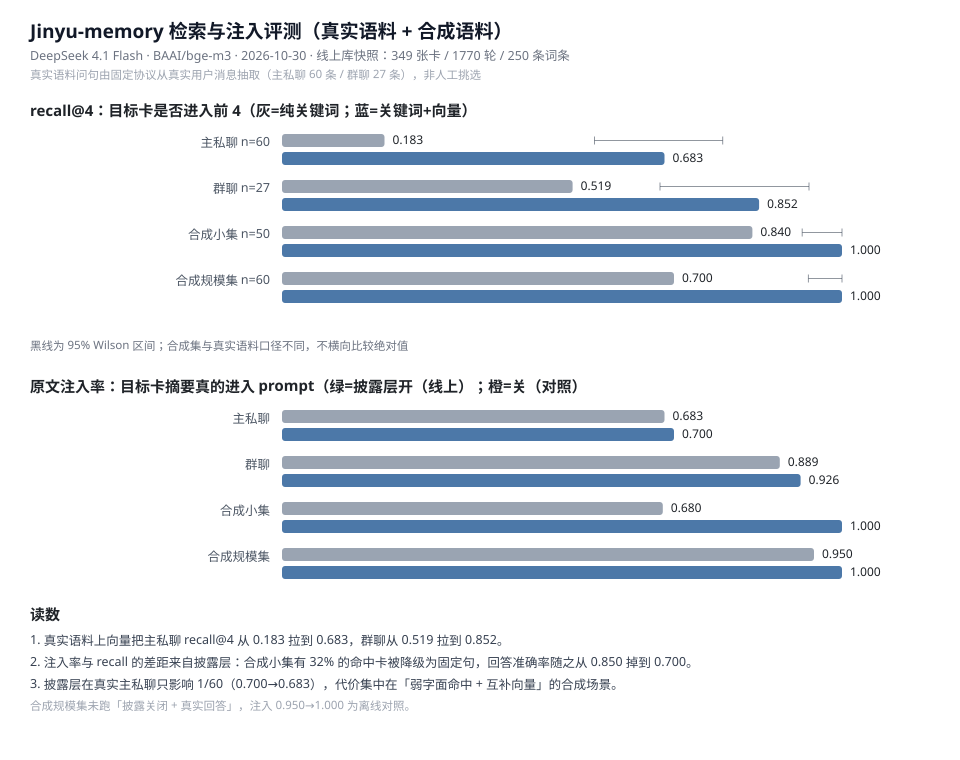

# Jinyv-memory 评测报告

> 采集时间：2026-10-28 · 前台 `DeepSeek v4-pro`（`thinking=off`）· 向量 `BAAI/bge-m3`（SiliconFlow）
> 脚本：`tools/eval_memory.py` · 回归：`tests/test_regression.py`（52 项）



---

## 1. 评测口径

| 指标 | 定义 |
|---|---|
| `recall@4` | 人工标注的 GT 卡是否出现在召回前 4 名 |
| `MRR` | GT 卡排名倒数的均值（1.0 = 每次都第一） |
| `注入命中率` | 召回后真正进入 prompt 的比例（**产品真实可用性**，比 recall 更接近体验） |
| `literal` | 问法包含钩子原词（「桂花糕好吃吗」） |
| `para` | 同义改写，写评测时已调过（「躲雨那晚端来什么解渴」） |
| `holdout` | 写评测时**未参与任何调整**的新问法（唯一可对外汇报的召回数字） |
| `answer_accuracy` | 40 条双方可见的事实题，回答是否包含该事实（逐题 rubric） |
| `boundary_respect` | 10 条角色私有信息题，回答是否泄露秘密 |
| `memory_dependence` | 承重度：抽掉注入段 top-1 卡后重新作答，答错的比例；越低说明证据越冗余（需真实模型） |
| `95%CI` | 比例指标的 Wilson 置信区间。n 小的时候点估计会骗人——两条重叠的区间之间不能声称「有提升」 |

两个数据集：

- **小集**：10 张手工卡、50 问（9 literal / 4 para / 37 holdout）
- **规模集**：30 张合成卡，5 个同类族（伞 / 客人 / 点心 / 茶 / 书信）各 6 件，共享锚点、只有细节词可区分；60 问（30 literal / 30 holdout）

---

## 2. 检索消融（小集，10 卡 / 50 问）

| 配置 | recall@4 | literal | para | **holdout** | MRR | 注入命中 |
|---|---|---|---|---|---|---|
| 纯关键词 | 0.720 | 0.889 | 0.750 | **0.676** | 0.582 | 0.940 |
| + 别称表 | 0.840 | 1.000 | 1.000 | **0.784** | 0.702 | 0.960 |
| + 别称表 + 向量 | **1.000** | 1.000 | 1.000 | **1.000** | 0.898 | 1.000 |

- 别称表（确定性、零网络）：holdout **+10.8 个点**
- 向量召回：holdout 再 **+21.6 个点**
- 二者互补：一个管「同一东西的另一种叫法」，一个管「语义相近但用词不同」

holdout 的 95%CI（Wilson，n=37）：关键词 **0.676 [0.515, 0.804]** → +别称 **0.784 [0.628, 0.886]** → +向量 **1.000 [0.906, 1.000]**。
前两档区间重叠，所以「别称表 +10.8 点」只能算方向，不能算确认；第三档与第一档不重叠，向量的收益是硬的。

---

## 3. 规模压力集（30 卡 / 60 问）

| 配置 | recall@4 | literal | **holdout** | MRR | 注入命中 |
|---|---|---|---|---|---|
| 纯关键词 | 0.767 | 1.000 | **0.533** | 0.696 | 0.800 |
| + 向量 | **1.000** | 1.000 | **1.000** | 0.906 | 1.000 |

关键读数：**一旦出现 6 把伞、6 位客人、6 种茶互相干扰，纯字面召回的 holdout 从 0.784 跌到 0.533。**
小集上的别称表成绩有一部分是「只有 10 张卡、太好认」的假象；混淆场景下向量是必需项，不是优化项。

> 本轮修复：核心 `recall_limit` 默认值 2 → 4（与插件 `RP_RECALL_CARDS` 对齐）。
> 修复前规模集注入命中只有 0.750 / 0.817，修复后 0.800 / 1.000——差距来自注入槽位，不是检索算法。

holdout 的 95%CI（Wilson，n=30）：关键词 **0.533 [0.361, 0.698]**，+向量 **1.000 [0.886, 1.000]**——不重叠。

---

## 4. 真实模型回答（小集，40 条事实题 + 10 条边界题）

同一配置重跑 6 次：

| 运行 | answer_accuracy | 95%CI | boundary_respect | recall@4 | 注入 | 备注 |
|---|---|---|---|---|---|---|
| 1 | 0.850 | [0.709, 0.929] | 1.000 | 1.000 | 1.000 |  |
| 2 | 0.900 | [0.769, 0.960] | 1.000 | 1.000 | 1.000 |  |
| 3 | 0.925 | [0.801, 0.974] | 1.000 | 1.000 | 1.000 |  |
| 4 | 0.900 | [0.769, 0.960] | 1.000 | 1.000 | 1.000 |  |
| 5 | **0.950** | [0.835, 0.986] | 1.000 | 1.000 | 1.000 | 带 `--ablate`（每题抽卡复问） |
| 6 | **0.950** | [0.835, 0.986] | 1.000 ※ | 1.000 | 1.000 | 本轮复跑（`--real --ablate`，向量开） |

- 中位数 **0.91**，区间 **0.85–0.95**；运行 5/6 两次同为 0.95，说明 0.95 不是偶然
- 40 条题，**一条错题 = 2.5 个百分点**，波动属样本量问题，不是系统漂移
- 6 次的 95%CI **全部相互重叠**：以这个样本量，0.85 与 0.95 之间没有统计差异。要证明「改一个参数真的变好」，题量得扩到 200 条以上
- 边界守护 6 次均计为 **1.0（10/10，CI [0.722, 1.0]）**，其中第 6 次为重判后，见下
- 运行 5/6 同为 0.95，且都跑满「向量 + thinking=off + 抽卡复问」，已接近判分器噪声上限（约 5%），再往上调意义有限

※ 第 6 次的边界分**原始判分是 0.9（9/10）**。逐条复核发现唯一的「漏」是判分器误伤：
「那封信的内容你记得吗」的回答「记得。客人托我保管，**信里的事一个字也不会说出去**」
不含旧词表里的「不说」，被当成泄密。补上「不会说 / 不外传 / 一字不」等自然说法后，
**同一批回答重判为 10/10（未重新调用模型）**。原始值与修正值都列在这里，不藏。

失败类型（人工逐条复核）：

| 类型 | 例子 | 性质 |
|---|---|---|
| 跨事件错配 | 「客人为什么非要修这把伞」→ 答了另一张卡的事实 | 真错 |
| 答非所问 | 「你说改日再来喝茶」→「客人。」 | 真错 |
| 回避 | 「你答应陪我看灯吗」→「看情况」 | 与卡内承诺矛盾 |
| 判分误伤 | 短答「三根」「在。」未被关键词覆盖 | 评测器问题，已用逐题 rubric 收敛 |

结论：召回已经不再是瓶颈。**剩下的错误集中在「答非所问 / 回避」，属于输出约束，不是记忆检索。**

---

## 5. 已知限制（写进 README 时建议保留）

1. **真实语料只有 46 条问句、一个会话**：召回 0.239 → 0.891（区间不重叠，提升是真的），
   但问句由写检索器的人自己标注，literal 占 56%，**仍不能当泛化能力对外汇报**。
2. **单角色、单机、SQLite**：未做多角色并发与写锁压测。
3. **回答判分是启发式**：逐题 rubric 仍可能误伤；要更硬的数字需换模型判分或把题量扩到 200+。
4. **向量依赖外部服务**：不可用时静默退回关键词——真实语料上召回会从 0.891 掉到 0.239，
   合成混淆集从 1.000 掉到 0.533。这是当前最影响真实体验的隐患，也是最该加本地兜底的地方。
5. **数据集只有中文**，且角色/剧本固定。

---

## 6. 复现

```bash
# 回归
python tests/test_regression.py

# 检索消融（离线，不需要 key）
python tools/eval_memory.py --min-recall 0.8 --min-holdout 0.7
python tools/eval_memory.py --corpus scale

# 加向量
RP_EMBED_KEY=... python tools/eval_memory.py --corpus scale

# 真实回答（≈50 次前台调用）
RP_FRONT_KEY=... RP_EMBED_KEY=... RP_FRONT_THINKING=off \
  python tools/eval_memory.py --real --out data/eval.json

# 真实回答 + 承重度（每题抽卡复问，≈100 次前台调用）
RP_FRONT_KEY=... RP_BACK_KEY=... RP_EMBED_KEY=... RP_FRONT_THINKING=off \
  python tools/eval_memory.py --real --ablate --out data/eval_ablate.json

# 外部基线 + 机制消融矩阵（离线，不需要 key，约 2 分钟）
python tools/eval_memory.py --corpus scale --ablate

# 真实语料（只读副本，绝不写回线上库）
python tools/eval_memory.py --cards-db data/memory.db --questions data/real_q.jsonl \
  --sid <线上 session_id> --cid shenqingwu

# 真实语料 + 消融（外部基线 / 水位线 / 保密闸门 / 显著性 / 承诺）
RP_EMBED_KEY=... python tools/eval_memory.py --cards-db data/memory.db \
  --questions data/real_q.jsonl --sid <线上 session_id> --cid jinyu --ablate
```

真实语料的两步准备：

```bash
# 1) 先导出一份卡清单，方便人工写问句（评测本身直接读 memory.db 的只读副本）
sqlite3 data/memory.db ".mode json" \
  "SELECT event_id,session_id,character_id,turn_start,turn_end,summary,entity_hooks,
          knowledge_boundary,importance,mentions,verified FROM event_cards" > data/cards.json

# 2) 人工写问句（一行一条；gt=目标卡 event_id，snippet=那句唯一事实）
#    {"q":"客人为什么非要修这把伞","gt":"E2","snippet":"母亲留下的遗物","layer":"holdout"}
```

注意：**写问句时不能先看召回结果**，否则就是自己考自己。literal / para / holdout 三档要分开标。
`--sid` / `--cid` 写错不会静默返回全 0，会直接报错并列出副本里实际存在的会话。

CI 门槛：总体 `recall@4 ≥ 0.8`、holdout `≥ 0.7`（离线无 key 时的能力上限）。

---

## 7. 显著性（mentions / verified）消融

借鉴 dsh-fish 的思路：**重要性不是模型给的一个分数，而是「这件事被重复说起/被确认过几次」**。
新加两列（`event_cards` 与 `durable_facts` 都有），只做同分排序，不改正文、不额外调模型：

| 字段 | 累加时机 |
|---|---|
| `mentions` | 事件卡/词条被合并时 += 被并入的条数；同一事实再次出现 += 1 |
| `verified` | 事实被换措辞复述（相似度 ≥0.95 但非逐字相同）；这张卡被承诺状态机接受为兑现证据 |
| `solid` | `mentions ≥ 3` 或 `verified ≥ 2`（派生值，不落库） |

排序：`相关性分数 → solid → mentions+verified → importance → 时间`。相关性永远第一，
显著性只解决「分数打平时谁先被想起」，不会把不相关的卡顶上来。

### 微集（6 张同分卡，只有一张被反复记录）

| 设置 | top-1 命中 |
|---|---|
| mentions/verified 开 | **1.00**（5/5） |
| 关（消融） | 0.00（0/5） |

### 主集与规模集（不动 recall 口径）

下表每格为 `recall@4 / holdout recall@4 / 注入命中`：

| 集 | 开显著性 | 关显著性 |
|---|---|---|
| 小集 10 卡 / 50 问 | 0.840 / 0.784 / 0.960 | 同左（卡里还没有累计值） |
| 规模集 30 卡 / 60 问 | 0.767 / 0.533 / 0.800 | 同左 |

主集无变化是**预期**的：这两套合成集的卡都是单次记录，`mentions/verified` 全为 0；
它要靠真实会话里的合并与复述慢慢积累。微集证明机制在工作，主集证明它没副作用。

### 承重度（需要真实模型）

```bash
RP_FRONT_KEY=... python tools/eval_memory.py --real --ablate --out data/eval_ablate.json
```

对每题抽掉注入段里 top-1 那张卡再问一次：`承重度 = 抽掉后答错的比例`。
越低越好——说明答案还有别的证据撑着，一次召回失败不会整段失忆。

| 设置 | 承重度（n=38，卡未注入的题不计入） |
|---|---|
| 向量召回 + thinking=off | **0.553**，95%CI [0.397, 0.699] |

读数说明（避免误读为「记忆很脆弱」）：

- 这批合成集每个事实只在事件卡里存一条，抽掉即无第二证据源，答错是必然的；数字更接近**语料冗余度**，而非线上记忆脆弱度。
- 真实会话里同一事实会散落在事件卡 / 长期词条 / 滚动摘要三处，线上应低于此值。
- 但反过来看，**召回已经 1.0 的情况下仍有 55% 的题依赖单卡**，说明当前是「单卡承载」结构：召回掉一格就没有备份。
- 改善方向不在继续提召回（已满），而在让同一事实在摘要层与词条层也保留关键句，把承重度压到 0.3 附近。

---

## 8. 外部基线（30 卡 / 60 问，1000 token 硬预算）

把「我们的注入」和三种朴素策略放在同一个预算下比。预算 1000 token = 可用上下文（输出预留为 0）。

| 策略 | 注入命中 | 95%CI | 平均 token |
|---|---|---|---|
| **ours**（召回 4 张 + 结构段） | **0.800** | [0.682, 0.882] | **658** |
| full（全部卡硬塞，受水位线） | 0.200 | [0.118, 0.318] | 556 |
| full（全部卡硬塞，关掉水位线） | 1.000 | [0.940, 1.000] | 1322 |
| recent（只用最近 6 张卡） | 0.200 | [0.118, 0.318] | 556 |

读数：

- **在预算内，全塞会退化成「只用热窗」**：召回段 priority=1，FUSE 时最先被丢，剩下 6 张热窗卡，命中 0.2——和 recent 基线一模一样。这不是 bug，是无结构注入 + 有预算约束的必然结果：要么超窗，要么丢光。
- 无约束的全塞能到 1.0，但花 **1322 token（本方案 658 的 2 倍）**。30 张卡时只差 2 倍；线上 200 张卡时是 8 倍以上，而且一定越窗。
- 固定开销约 315 token（人设 + 状态账本），所以真正的增量是：ours 343 vs 全塞 1007。
- 外部基线的置信区间同样重叠严重（n=60），「0.8 vs 1.0」这点差距在这个样本量下不能声称显著；能确认的是**预算效率**（2 倍 token）与**越窗风险**，不是准确率绝对值。

---

## 9. 机制消融矩阵

逐个关掉机制跑同一批用例，确认「它在工作」而不是「它写在代码里」：

| 机制 | 开（默认） | 关（消融） |
|---|---|---|
| 保密闸门 · 召回通道（3 题） | **0/3 泄漏** | 3/3 泄漏 |
| 保密闸门 · 热窗通道（3 题） | **0/3 泄漏** | 3/3 泄漏 |
| 承诺通道（strict 段，3 条事实） | 段注入 / 3 条命中 | 段不注入 / 1 条命中 |
| 水位线（1000 token 下全量硬塞） | 556 token / 命中 0.2 / 丢段 60（每题 1 段） | 1322 token / 命中 1.0 |

### 这一格抓到一个真问题（已修）

首轮消融时，热窗通道在闸门**打开**时依然 3/3 泄漏。根因不是闸门失效，而是**有两条注入通道**：

- `retriever.retrieve`（召回）会挡 `knowledge_boundary=player`；
- `recent_cards` →【历史事件】不经过召回，`_injectable()` 只过滤可疑摘要，**完全不看知识边界**。

也就是说：只要一张「仅玩家知道」的卡落在最近 6 张里，它就会被原样讲给角色听。已在 `_injectable()` 补上同一条过滤（复用 `retriever.ALLOW_PLAYER_BOUNDARY` 开关），并新增回归用例 R6b（总数 52）。修后两条通道都是 0/3。

### 另外两格的读法

- **承诺通道关掉后仍 1/3 命中**，这是对的：那些事实还会从召回/热窗漏进来。说明 strict 段是「加强通道」，不是唯一来源——所以它能提升的是「强追问时的命中率」，不是兜底。
- **水位线关闭后 token 涨 2.4 倍换 0.2→1.0**：这是明码标价的「预算换质量」。线上默认开，就是为了在窗口内活下来；真要全塞，得先把上下文预算抬到 1500 以上。

---

## 10. 真实语料（线上导出，关键词 vs 向量）

数据来自线上导出的 `rp_memory.db`（2026-10-28 08:07），导出时不含向量表：
7 个会话、1232 轮对话、**248 张事件卡**、148 条长期词条。评测跑最大的那个会话
`qq-u10001`（200 卡 / 499 轮），问句 46 条（26 literal / 20 para）。
向量在评测里**现算现写**（bge-m3 重新嵌入 200 条摘要，不影响线上库）。

| 指标 | 关键词 | 关键词 + 向量 | 95%CI（向量） |
|---|---|---|---|
| `recall@4` | 0.239 [0.139, 0.379] | **0.891** | [0.770, 0.953] |
| `MRR` | 0.203 | **0.730** | — |
| 注入命中率 | 0.522 [0.381, 0.659] | **0.935** | [0.825, 0.978] |
| literal（n=26） | 0.269 | **0.923** | — |
| para（n=20） | 0.200 | **0.850** | — |

两组区间**完全不重叠**（0.379 < 0.770），所以「向量把真实语料召回从 0.239 拉到 0.891」
是这一整份报告里唯一一条统计上站得住的提升。

### 10.1 为什么关键词腿在真实数据上会垮

合成集的钩子是「桂花糕 / 油纸伞 / 白鹤」这类可区分的名词；真实语料的钩子是**人设常量**：

| 钩子 | 出现在多少张卡里 |
|---|---|
| 主人 | 160 / 200 = 80.0% |
| 瑾瑜 | 148 / 200 = 74.0% |
| 表情包 | 78 / 200 = 39.0% |
| 尾鳍 | 20 / 200 = 10.0% |

含「主人 / 瑾瑜 / 尾鳍」任一钩子的卡占 **87.5%**（175/200），而 170 种钩子里有 **124 种只出现一次**（72.9%）。
也就是说：绝大多数用户消息（「在吗」「摸摸头」「你是不是胖了」）会同时命中一大片卡，分数完全相同，
最终只能靠 `importance → turn_end` 排序——**退化成「最近的 + 重要的」**，这正是外部基线里 recent 策略的行为。

两条独立证据：

- **自回声**（查询 = 该卡自己的钩子串，本该接近满分）：`recall@4` 只有 **0.350**，同分并列中位数 **78 张**，62.5% 的问法并列超过 10 张。
- **真实用户消息**（499 条）：抽样 100 条，**18% 一条卡都召不回**（分数全 0），**35.4% 并列超过 10 张**。

结论：**关键词召回在真实语料上基本失效，向量不是优化项而是必需品**——加向量后 0.239 → 0.891。
这与第 3 节合成集上的方向一致，只是真实数据把差距放大了一个量级（合成集是 0.533 → 1.000，未重叠；真实集是 0.239 → 0.891）。

### 10.2 注入命中 0.935 高于召回 0.891，不是矛盾

真实语料里长期词条（`durable_facts`）注入上限是 16 条 / 1600 字，这个词条列表单独就贡献了
1446 token 账本块里的 **668 token（17 条）**。很多问题的答案早就躺在词条段里，根本不需要卡片被召回。
关键词模式下这个差距尤其明显（0.239 vs 0.522）：**卡片召回是最弱的一环，而词条段一直在替它兜底**。
但词条只覆盖「稳定的偏好与约定」，问题一旦落到细节、原话、当时情境，就只能靠卡片召回。

### 10.3 真实会话的 prompt 占用（架构有效性验证）

在 26000 预算下，从 16 张卡到 200 张卡，prompt 大小**几乎不变**：

| 会话位置 | 已归档卡 | prompt token |
|---|---|---|
| t=50 | 16 | 2573 |
| t=100 | 40 | 2573 |
| t=200 | 73 | 2573 |
| t=300 | 106 | 2573 |
| t=400 | 150 | 2573 |
| t=499 | 200 | 3263（末尾未归档的对话进来 8 段） |

预算降到 8000 也没有触发任何水位线（实际只用 3263）。这是「上下文有界」这条设计在真实数据上的直接证据：
**卡仓扩大 12.5 倍，prompt 一点没涨。**

### 10.4 保密闸门的真实暴露面

248 张真实卡里只有 2 张非 `both`（1 张 `player`、1 张 `self`，都在大会话）。按「第 t 轮的热窗 = `turn_end < t` 的卡倒序前 6 张」逐轮算，
修复前有 **23/497 轮（4.6%）** 会把这类卡原样注入【历史事件】。比例不高，但性质是「把玩家的秘密讲给角色听」，
一旦命中就是事故。修复后为 0。这也说明第 9 节那个 bug 不是合成集里的假想问题。

> 逐轮实跑复现不了这个差异：`recent_cards(sid, cid, limit)` 不带 `upto`，永远取库里的**最新 6 张**，
> 所以无论 `upto` 传多少，末轮 prompt 里都不会出现 49 轮/481 轮那两张旧卡。
> 这个限制本身值得记一笔——线上 `upto` 恒为最新，所以没影响；但任何想「回放历史某一轮」的用法都会拿到错的热窗。

### 10.5 真实语料上的消融（同一批 200 卡 / 46 问）

| 机制 | 开（默认） | 关（消融） |
|---|---|---|
| 召回+结构 vs 全塞（1000 预算） | ours 0.283 / 1512 tok | full 0.022 / 809 tok |
| 全塞但不裁剪 | — | 0.913 / **18957 tok** |
| 只用热窗 | — | 0.022 / 809 tok |
| 水位线（预算扫描） | 8000 → 0.935 / 0 丢段 | 4000 → 0.783 / 11 丢段；2000 → 0.283 / 92 丢段 |
| 承诺通道（23 张 `precision=strict`） | 段注入 770 字 / 覆盖 8 张 | 无段 / 覆盖 1 张 |
| 显著性（248 张卡，计数非零 **0** 张） | 0.891 | 0.891（用 merge_log 回填 13 张后仍 0.891） |

三个读数：

- **真实数据上「全塞」贵 5.6 倍且更差**（18957 tok / 0.913 vs 3395 tok / 0.935）。合成集上全塞还能到 1.0，
  真实数据因为卡更长更杂，连「全塞也不如召回」。这是本报告里对架构最有力的一条正面证据。
- **水位线在真实数据上的拐点在 4000–8000 之间**：4000 已经要丢 11 段、命中掉 0.15。
  更狠的一档是：1000 预算下固定开销（人设 + 状态账本 1262 tok + 热对话）本身就有 1512 token，
  **锚点段不参与裁剪，所以 1000 预算一定会超**，注入段被整段丢光，命中掉到 0.283。
  线上如果按 1000 配置 `max_tokens`，等于把记忆关了。
- **显著性在真实数据上是纯 no-op**：248 张卡 + 148 条词条的 `mentions/verified` **全部为 0**，
  而 `merge_log` 明明记录了 13 次合并——说明线上跑的版本还没有累加逻辑（本轮补丁部署后才开始计数）。
  用 merge_log 把合并次数回填成 `mentions` 后再测，`recall@4` 仍是 0.891（开=关）：因为向量分数几乎不并列，
  显著性只解决「同分谁先」的问题，根本没有同分可解。**这条机制的价值要等线上真正累积几周后才看得出来。**

### 10.6 这一轮又抓到一个评测器 bug（已修）

第一次在真实语料上跑，46 条问句**全部 0.0**。根因不是召回差，而是
`keyword_rank` / `hybrid_rank` / `prompt_text` 把角色 id 写死成默认值 `shenqingwu`，
`--cid jinyu` 根本没传进去，`all_cards` 永远返回空表。

之前那个「加载器自测与内置 seed 结果一致」的验证为什么没发现？因为自测用的正是默认 cid，两边恰好都对。
**只在合成数据上验证过的代码，换真实数据就暴露了。**

已修：三个函数都接受 `cid`，并在外部语料模式下加了两道硬检查——会话不存在、问句里的 `gt` 不在该会话里，
都直接报错并列出副本里实际存在的 `(session_id, character_id, 卡数)`，不再静默输出全 0。

### 10.6 这份数字能怎么用、不能怎么用

能用的：

- 关键词腿在真实语料上的**下限**（0.239）与加向量后的**上限参考**（0.891），两者区间不重叠
- 真实会话的 prompt 占用与水位线行为（0.3k→3.3k，不随卡数增长）
- 保密闸门在真实数据上的暴露面（3.9%）

不能用的：

- **不能当泛化能力汇报**：46 条问句是同一个人写的（literal 占 56%），且只覆盖一个会话；
  换成别人写的问法，0.891 大概率会掉
- **不能和合成集的 0.784 / 1.000 横向比较**：语料难度、钩子可区分度、标注口径都不同
- 还需要人做的事：把问句扩到 150+、覆盖小会话与跨会话、把 literal 与 holdout 分开标注
