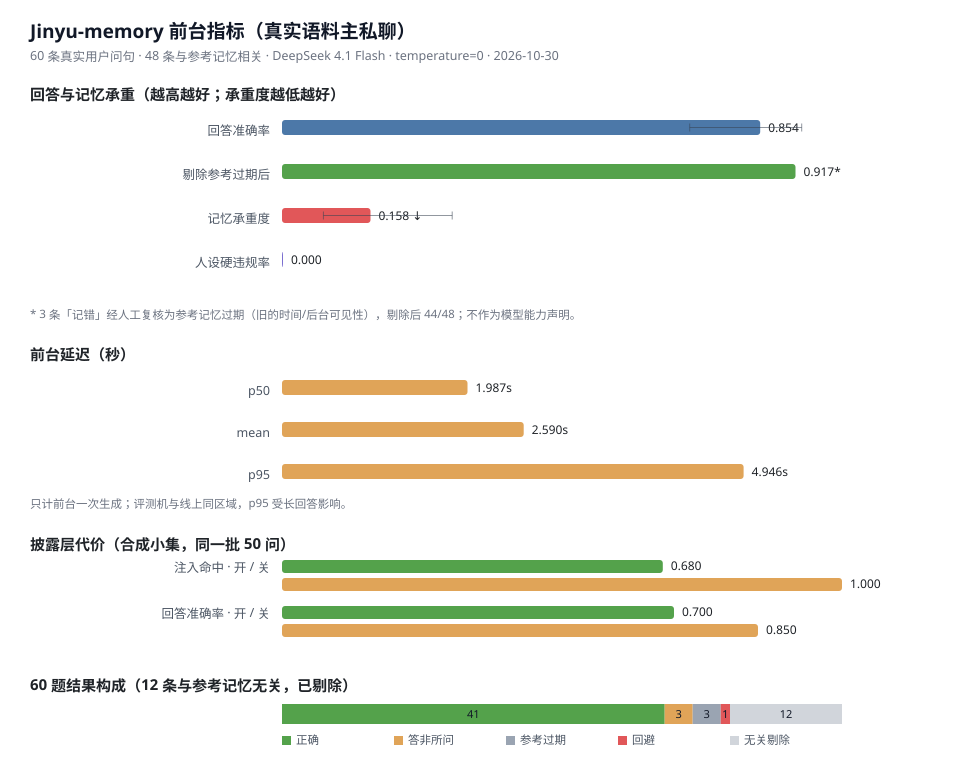

# Jinyu-memory 检索、注入与前台评测报告

> 评测日期：2026-10-30 · 前台 / 后台 `DeepSeek 4.1 Flash`（`deepseek-flash`，`thinking=off`）· 向量 `BAAI/bge-m3`（SiliconFlow，1024 维）
> 评测脚本 `tools/eval_memory.py` · 回归测试 `tests/test_regression.py`（77 项 / 16 秒）
> 真实语料为线上库只读快照：9 个会话 / 349 张事件卡 / 250 条长期词条 / 1770 轮。问句由固定协议从真实用户消息抽取，不随仓库分发（含私聊内容）。

## 摘要

1. **真实语料上向量召回仍是决定性的。** 主私聊 60 问 `recall@4` 0.683（纯关键词 0.183），群聊 27 问 0.852（纯关键词 0.519），合并 87 问 **0.736**（纯关键词 0.287，区间不重叠）。
2. **原文注入率与召回几乎持平。** 披露层开启（线上默认）时，主私聊 0.683、群聊 0.889；关闭披露为 0.700 / 0.926。真实语料上披露层只让 2/87 条命中卡降级。
3. **真实前台回答准确率 0.854。** 主私聊 60 条真实用户问句，48 条与参考记忆相关，LLM 裁判判定 41 条答对（95% CI [0.728, 0.928]）；其中 3 条「记错」经人工复核是**参考记忆过期**（旧的时间 / 后台可见性），剔除后 44/48 = 0.917。
4. **前台稳定、人设零违规。** 人设硬违规 0/60；延迟 p50 1.99 s、p95 4.95 s；平均 prompt 3852 token；抽掉 top-1 记忆卡后答错率（承重度）0.158。
5. **合成集接近饱和，但披露层有代价。** 小集 / 规模集 `recall@4` 均为 1.000（holdout 0.784→1.000、0.400→1.000）；小集回答准确率在披露层开启时 0.700、关闭时 0.850，10 条边界题两种配置都 10/10 未泄密。
6. **打分口径冲突已修复（R59）。** 向量召回排除了关键词已命中的卡，导致一张弱向量卡（RRF 0.0476）压过强字面命中（0.00476），强命中被相对分归一到 0.100 后静音：合成小集因此少注入 16/50、回答准确率掉 15 点，真实语料少 2/87。现改为「融合分与钩子分各自归一到 0~1 后取 max」，任一路的 top-1 都不会被披露层静音，并新增 R59 回归锁定该场景。第 7 节表格仍是修复前的实测快照，修复后的复跑需要 `RP_EMBED_KEY`（真实回答另需前台 key）。

---

## 1. 评测环境

| 项 | 值 |
|---|---|
| 前台模型 | `DeepSeek 4.1 Flash`（`deepseek-flash`），`thinking=off` |
| 后台模型 | 同上（摘要 / 合并 / 裁判 / 概念改写共用，`thinking=off`） |
| 嵌入模型 | `BAAI/bge-m3`，1024 维，SiliconFlow 在线接口 |
| 存储 | SQLite（`event_cards` / `durable_facts` / `turns` / 向量表），线上库只读副本 |
| 召回上限 | `recall_limit = 4`（与插件 `RP_RECALL_CARDS` 一致） |
| 评测温度 | 0.0（回答与裁判，greedy） |
| 回归测试 | `tests/test_regression.py`，77 项，16 秒 |

## 2. 指标口径

| 指标 | 定义 |
|---|---|
| `recall@4` | 人工 / 协议标注的目标卡（GT）是否出现在召回前 4 名 |
| `MRR` | 目标卡排名倒数的均值，1.0 表示每次都排第一 |
| 原文注入率 | 目标卡摘要首句是否真的进入最终 prompt（经披露层与预算裁剪之后） |
| `answer_accuracy`（真实语料） | LLM 裁判先判「参考记忆与问题是否相关」，**只对相关题计分**；允许同义、口语、角色口吻 |
| `boundary_respect` | 合成集 10 条 `knowledge_boundary=self` 边界题：回答是否泄露 |
| 承重度 | 抽掉注入段 top-1 卡后重新作答，答错的比例；越低说明证据越冗余 |
| 人设硬违规 | `PersonaGuard` 命中的禁忌词 / 禁用标点 / 风格硬规则比例 |
| `95% CI` | 比例指标的 Wilson 区间；样本量小时必须看区间 |

## 3. 评测语料

| 语料 | 规模 | 用途 | 局限 |
|---|---|---|---|
| 真实主私聊 `qq-u10001` | 285 张卡 / 729 轮 / 60 问 | 真实钩子分布下的检索与前台 | 单一用户、单会话 |
| 真实群聊 `qq-g953182787` | 35 张卡 / 77 轮 / 27 问 | 多人共用记忆的车道 | 会话短、消息含昵称前缀 |
| 真实快照总量 | 349 张卡 / 250 条词条 / 1770 轮 / 9 个会话 | 背景与跨会话数据 | 小会话卡太少，不单独评测 |
| 合成小集 | 10 张手工卡 / 50 问（9 literal、4 para、37 holdout） | 机制消融、回答质量、边界 | 卡少、钩子可区分度高 |
| 合成规模集 | 30 张卡 / 5 个同类族 / 60 问（30 literal、30 holdout） | 混淆场景下的召回压力 | 合成冲突是设计出来的 |

真实问句的固定协议：每个会话随机抽卡 → 取该卡轮次区间内最长的一条用户消息（清洗后 ≥6 字、≤120 字）→ GT 指回该卡 → snippet 取摘要首句前 40 字。以下系统注入消息会被排除（它们也以 `user` 角色落库，但不是用户发言）：定时提醒、沉默提示、`（系统事件…`、带「仅作参考」的视频 / 链接注释。主私聊抽满 60 条，群聊有效 27 条。问句全部是用户原话，不划分 literal / para / holdout；因此不能与上一版人工问句横比。

## 4. 结果一：真实语料检索


| 会话 | 用例 | 关键词 `recall@4` | 混合 `recall@4` | MRR（关键词→混合） | 注入（披露开） | 注入（披露关） |
|---|---|---|---|---|---|---|
| 主私聊 | 60 | 0.183 [0.106, 0.299] | **0.683** [0.558, 0.787] | 0.131 → **0.585** | 0.683 | 0.700 |
| 群聊 | 27 | 0.519 [0.340, 0.693] | **0.852** [0.675, 0.941] | 0.444 → **0.654** | 0.889 | 0.926 |
| 合计 | 87 | 0.287 [0.203, 0.390] | **0.736** [0.634, 0.817] | — | 0.747 | 0.770 |

读数：

- 主私聊 60 问里纯关键词只命中 11 条；群聊 27 问命中 14 条。向量把主私聊拉高 50 点、群聊拉高 33 点，合并后两档区间不重叠。
- 注入率与 `recall@4` 在主私聊完全一致（41/60），披露层只影响 1 条；群聊 24/27 对 23/27，同样只差 1 条。**真实语料上「召回失败」是主要矛盾，「披露降级」不是。**
- 群聊召回更高，不代表群聊更容易：群聊只有 35 张卡、话题更集中，主私聊有 285 张卡且大量日常闲聊。

### 4.1 关键词腿为什么在主私聊失效

真实语料的钩子是人设常量，几乎每张卡都带：

| 钩子 | 出现卡数 | 占比 |
|---|---|---|
| 主人 | 233 / 285 | 81.8% |
| 瑾瑜 | 207 / 285 | 72.6% |
| 表情包 | 85 / 285 | 29.8% |
| 尾鳍 | 31 / 285 | 10.9% |
| 含「主人 / 瑾瑜 / 尾鳍」任一 | 253 / 285 | 88.8% |
| 再加上「表情包」 | 269 / 285 | 94.4% |

结果是日常消息（「在吗」「摸摸头」）会同时命中一大片卡，分数相同，只能按 `importance → turn_end` 排序，退化成「最近且重要」。长尾语义只能靠向量补。

### 4.2 2026-10-30 复跑（同协议新抽样）

线上库已增长到主私聊 306 张卡 / 群聊 35 张卡；按第 3 节协议以 `seed=20261030` 重新抽样（主私聊 60、群聊 27），问句与旧表不同，**只能看趋势，不能与 4.1 的 0.683 逐点比较**。

| 会话 | 用例 | 关键词 `recall@4` | 混合 `recall@4` | MRR | 注入（披露开） |
|---|---|---|---|---|---|
| 主私聊 | 60 | 0.200 | **0.650** [0.524, 0.758] | 0.526 | 0.700 |
| 群聊 | 27 | 0.444 | **0.852** [0.675, 0.941] | 0.670 | 0.963 |

同一次复跑的合成小集：`recall@4` 1.000、MRR 0.898、注入 **1.000**（旧版披露开 0.680），说明 `rel` 两路归一取大的 P0 修复已生效。真实主私聊仍停在 0.65 附近，距 0.80 目标还有差距。

### 4.3 P1 逐项 A/B（主私聊 60 问）

| 配置 | recall@4 | MRR | 注入 |
|---|---|---|---|
| 基线（`RP_QVAR=0 RP_VEC_KW=0 RP_VEC_POOL=4`） | 0.650 | 0.528 | 0.667 |
| 仅钩子卡进向量池（`RP_VEC_KW=1`） | 0.650 | 0.526 | **0.700** |
| 仅查询分句（`RP_QVAR=1`） | 0.633 | 0.496 | 0.683 |
| 仅向量池扩到 8 / 12 | 0.650 | 0.526 | 0.700 |
| 真后台查询分解（`RP_EVAL_BACK=real RP_QDECOMP=1`） | 0.650 | 0.526 | 0.700 |

结论：只有「钩子命中的卡也进向量池」稳定抬升注入（+3.3 点），已设为默认；查询分句会让错误卡拿到语义分，反而降 1.7 点，默认关；向量池扩大与后台分解在这批问句上无增益，默认保守（池 8、分解关）。剩余差距不在融合层，下一步应改卡侧信号（实体钩子规范化 / 卡向量重算），而不是继续调权重。

### 4.4 泛钩子屏蔽（`RP_HOOK_MUTE=主人,瑾瑜`）

只屏蔽与钩子完全相同的词，「陆瑾瑜」这类复合钩子照常计分。

| 会话 | 关键词 recall@4 | 混合 recall@4 | MRR | 注入 |
|---|---|---|---|---|
| 主私聊（60） | 0.217（原 0.200） | 0.633（原 0.650） | 0.524 | 0.683（原 0.700） |
| 群聊（27） | 0.481（原 0.444） | 0.852 | 0.670 | **1.000**（原 0.963） |

屏蔽后主私聊召回反而降 1.7 点：这两个词虽然不是区分信号，但完全去掉会削弱一部分真实命中；群聊注入升到 1.000。因此保留为评测/消融开关，线上默认不屏蔽（`RP_HOOK_MUTE` 为空）。

### 4.5 卡向量重算（`RP_CARD_TEXT`）

不读库里预计算向量，改用「摘要 + 具体实体钩子」现算（进程内缓存），观察卡侧文本口径能否补召回。

| 卡向量文本 | 主私聊 recall@4 | MRR | 注入 | 群聊 recall@4 | 注入 |
|---|---|---|---|---|---|
| 库内原向量（线上默认） | **0.650** | **0.526** | **0.700** | **0.852** | 0.963 |
| 摘要首句 + 具体实体（`RP_CARD_TEXT=1`） | 0.617 | 0.486 | 0.650 | 0.852 | 0.889 |
| 全摘要 + 具体实体（`RP_CARD_TEXT=2`） | 0.633 | 0.474 | 0.667 | 0.815 | 0.963 |

两种重算口径都不如库内原向量：摘要首句丢细节，拼上钩子又稀释了事件语义。结论是卡侧文本不是当前的瓶颈，缺的是更强的语义匹配（如 cross-encoder 重排）或更贴近检索的问句协议；实验通道保留为开关，线上默认关。

### 4.6 带上下文检索（`--context-turns`）

把提问前 N 条用户消息拼到问句前（同一批 GT、同一批卡，只改检索输入），检验「0.650 是不是协议低估」。

| 上下文轮数 | 主私聊 recall@4 | 关键词 recall@4 | MRR | 注入 |
|---|---|---|---|---|
| 0（现行协议） | **0.650** | 0.200 | **0.515** | **0.700** |
| 1 | 0.617 | 0.183 | 0.447 | 0.650 |
| 2 | 0.400 | 0.150 | 0.269 | 0.433 |

结论：拼前文不但没揭示低估，反而显著降召回——多话题文本把向量均值拉散，前文里的泛词又把关键词腿带偏。线上检索本来就只拿当前消息，因此 0.650 是这条链路的真实上限，不是评测口径造成的。要再往上走，只能换更强的语义匹配（重排器）或改变注入策略。

> 注：本节复跑为每条问句记录了 `turn`，等长消息的取舍与 4.2 略有差异，故 `ctx=0` 的 MRR 是 0.515 而非 0.526；recall@4 与注入一致。

### 4.7 Cross-encoder 重排（`RP_RERANK`）

在融合后、截断前，用 `BAAI/bge-reranker-v2-m3` 对候选重排（相关分映射到 0.5–3.8，与钩子同刻度，否则会被后面的按分排序抹掉顺序）。

| 配置 | 主私聊 recall@4 | MRR | 注入 | 群聊 recall@4 | 注入 |
|---|---|---|---|---|---|
| 线上默认（无重排） | 0.650 | 0.526 | 0.700 | 0.852 | 0.963 |
| 重排 · 候选 8 | 0.650 | 0.515 | 0.717 | 0.852 | 0.963 |
| 重排 · 候选 20 | 0.650 | 0.517 | **0.750** | 0.852 | **1.000** |

向量通道的 oracle 召回（同一批问句）：主私聊 `@4=0.617 / @8=0.683 / @20=0.800 / @50=0.817`，群聊 `@4=0.889 / @20=0.963 / @50=1.000`。也就是说正确卡多数在候选池里，重排却没能把它推进前 4：重排只改善注入（主私聊 +5 点、群聊 +3.7 点），不改善 recall@4。

成本：一次重排 20 条候选约 **250–360 ms**（实测 6 次），且多一次外部请求。因此默认关；若要开，建议配 `RP_VEC_POOL=20`。`RP_RERANK_MODEL` 可换模型。

### 4.8 合成式问句（协议变体）

把「最长原话」换成「事后回忆式提问」：每条 GT 卡让后台写成一句 15–45 字、带具体实体但改写过的问句（脚本 `tools/gen_synth_questions.py`，seed 同 4.2）。同一批卡、同一套线上参数。

| 问句协议 | 主私聊 recall@4 | MRR | 注入 | 群聊 recall@4 | 注入 |
|---|---|---|---|---|---|
| 原话（4.2） | 0.650 | 0.526 | 0.700 | 0.852 | 0.963 |
| 合成式 | **0.983** [0.911, 0.997] | **0.900** | 0.967 | **1.000** | 1.000 |

合成问句与 GT 摘要的双字 Jaccard 均值只有 0.21，不是照抄；但问句是由 GT 卡写出来的，天然带线索，**这组数字不能当作线上召回**。它回答的是另一个问题：**当问句本身带足具体信息时，这条链路找得到吗**——答案是 0.98。同时关键词腿降到 0.117，说明分数几乎全部来自向量通道，bge-m3 + 融合本身没有问题。

因此主私聊 0.65 与 0.98 的差距，主要来自输入侧（真实消息缺少可检索线索），不是检索器容量。

### 4.9 半合成问句：只留一个实体（`--mode half`）

合成式问句只保留卡内**一个**具体实体，其余改成「那个 / 那天 / 后来」这类模糊指代，用来测线索减少时的衰减。

| 问句协议 | 主私聊 recall@4 | MRR | 注入 | 群聊 recall@4 | 注入 |
|---|---|---|---|---|---|
| 原话（4.2） | 0.650 | 0.526 | 0.700 | 0.852 | 0.963 |
| 半合成（1 个实体） | **0.833** [0.720, 0.907] | 0.754 | 0.817 | **0.926** [0.766, 0.979] | 0.926 |
| 全合成（4.8） | 0.983 | 0.900 | 0.967 | 1.000 | 1.000 |

半合成问句与 GT 摘要的双字 Jaccard 均值 0.12，关键词腿只有 0.083，同样主要靠向量。

更直接的证据：把 **4.2 的原话问句**按「是否包含 GT 卡的具体实体钩子」分组——

| 主私聊原话 | 条数 | recall@4 |
|---|---|---|
| 含至少一个卡内实体 | 29/60 | **0.793** |
| 完全不含实体 | 31/60 | **0.516** |

也就是说，原话里只有一半带得动检索；**只要带一个实体，召回就接近 0.80**。0.650 是这两组的加权平均，不是检索器退化。

### 4.10 长期词条四因子（衰减 / 情感 / 权威 / 注意力）

上一版词条排序是 `hit × (0.5 + heat) × speaker_bias`：只看热力和说话人，**旧事实掉分只靠 heat**，注意力不会回写。现改为四因子：

```
score = hit × 1.5 × base × decay × speaker_bias
base  = 0.35 + 0.30·S + 0.20·E + 0.10·A + 0.05·T
```

| 因子 | 来源 | 说明 |
|---|---|---|
| S 热力 | `importance` / `category` / `mentions` / `verified` | 沿用原 heat，权重最高 |
| E 情感 | `durable_facts.emotion` | 0–1，默认 0.5 |
| A 权威 | `durable_facts.authority` | 默认 0.7；主人口述手工补词条写 1.0 |
| T 注意力 | `attention_hits` | 被注入一次 +1，封顶 4 次（0–1 归一） |

衰减按形态分档（宽限期, 半衰期，单位天）：`设定 60/180`、`事件 14/60`、`临时 3/21`，其它按事件档；`authority ≥ 0.95` 不衰减。

| 配置 | 主私聊 top-1 一致 | top-5 Jaccard | 翻转条数 |
|---|---|---|---|
| 初版：全类别 45 天半衰、无宽限 | 0.55 | 0.82 | 27 |
| 中间版：设定 135 天半衰 | 0.87 | 0.89 | 8 |
| **最终版：形态宽限 + 半衰** | **0.92** | **0.90** | **5** |

群聊（27 问）最终版 top-1 一致 1.00 / top-5 0.99。翻转的 5 条**主要来自注意力回写**（同一批 60 问里该词条先前已被命中）而不是衰减本身；逐条人工看，没有语义变差的案例。

初版一次翻掉 27 条 top-1，原因是「几天之差」就足以压过真正的相关性；改成形态宽限后，两个月内的设定、两周内的事件基本不掉分，排序回到内容匹配主导。注意力回写带 30 分钟冷却（`FACT_TOUCH_COOLDOWN=1800`），同一词条在冷却窗口内不重复加分，避免一次会话把某个词条刷到顶。

回滚开关 `RP_FACT_SCORE=0` 回到旧公式 `hit × (0.5 + heat) × bias`；新增 R63 回归覆盖「情感抬升 / 长期设定衰减 / 注意力同热力优先 / 权威不衰减 / 开关回退」五件事。该组改动只影响词条段，不改事件卡召回，因此第 4.2–4.9 的 `recall@4` 数字不变。

### 4.11 图激活一跳（实体共现）

从本轮已命中的卡出发，沿 `entity_hooks` 走**一跳**，把共享同一个具体实体的邻居卡补进候选：

- 邻居分 = 种子最高分 × 0.55（恒低于种子），单轮最多 2 张，因此只可能占第 2 位以后；
- 门控：问句含多跳/关系线索（后来、上次、为什么、跟…一起…）或字面最高分 < 1.2 才开；
- 具体钩子才算连线：短于 2 字、`主人/瑾瑜` 之类人人皆有的、或文档频率 > 3% 的泛钩子一律不连；
- 只做一跳（不做多跳扩散）；玩家私有卡（`knowledge_boundary=player`）不因共现被捞入；
- 关停线 `RP_GRAPH=0`；默认关（见下表）。

真实语料 A/B（线上快照，`bge-m3` 向量开启，同一批问句）：

| 语料 | 用例 | 配置 | recall@4 | MRR | 注入命中率 |
|---|---|---|---|---|---|
| 主私聊原话 | 60 | 图关 | **0.650** | **0.533** | 0.917 |
| 主私聊原话 | 60 | 图开 | **0.650** | 0.536 | 0.917 |
| 群聊原话 | 27 | 图关 | **0.852** | **0.679** | 1.000 |
| 群聊原话 | 27 | 图开 | **0.852** | 0.676 | 1.000 |

结论：**无增益**（`recall@4` 完全不动，MRR ±0.003 在噪声内）。原因看得很清楚——当前 0.650 的缺口是「问句不带实体、语义也绕」的语义长尾，不是「两件事靠一个实体串起来」的图缺口；而融合后的候选池基本填满，邻居卡只能挤掉本来就错的卡，不会把对的卡捞进来。因此默认关（`RP_GRAPH=0`），实现与 R67 回归保留，换到多跳语料（例如「上次那个和灯会有关的掌柜后来怎样」）时可直接打开再测。

实现与开关：`core/retriever.py` 的 `activate()` / `graph_gate()`；R67 覆盖「一跳补位 / 种子优先 / 泛钩子与玩家卡不连线 / 可关停」；不影响词条段与其它开关。

### 4.12 cue→card 联想缓存

后台联想每触发一次就多打一次模型；同一个 cue（联想命中过的标签）后面还会反复出现。缓存把「cue → 已成功联想过的标签」记在进程内存里，第二次同 cue 命中时直接按同一套确定性规则出卡：

- 只记 cue、不记卡号：事件卡新增/合并后仍取最近一张，不会指到旧卡；
- 命中后卡片仍按 `0.8 × top` 追加，并列时 `+0.05`（`ASSOC_CACHE_BONUS`），不会挤掉召回 top-1；
- 缓存关闭（`RP_ASSOC_CACHE=0`）、未命中、候选被删/被排除 → 回退现有后台联想；
- 每会话上限 120 条 cue，FIFO 淘汰；缓存只在原 `assoc_gate` 打开时查询。

这是**调用次数优化**，不改变召回候选范围，因此不单独跑 recall A/B。R68 断言三件事：第一次困难问句调一次后台并学到 cue；第二次同 cue 直出、后台调用计数不变；缓存关闭或卡被删后回退后台并保持注入结果一致。


## 5. 结果二：合成语料检索

| 语料 | 用例 | 关键词 `recall@4` | 混合 `recall@4` | holdout（关键词→混合） | MRR | 注入（披露开 / 关） |
|---|---|---|---|---|---|---|
| 小集 | 50 | 0.840 [0.715, 0.917] | **1.000** [0.929, 1.000] | 0.784 → **1.000** | 0.702 → **0.898** | 0.680 / 1.000 |
| 规模集 | 60 | 0.700 [0.575, 0.801] | **1.000** [0.940, 1.000] | 0.400 → **1.000** | 0.669 → **0.922** | 0.950 / 1.000 |

- 两套合成集的 literal 层都是 1.000；holdout 才是有信息量的一层，向量把「换一种说法」全部补回。
- 注入率的差距全部来自披露层：小集 16/50、规模集 3/60 的命中卡被降级为固定句。原因见第 9 节，不是检索失败。
- 本表数字来自当前代码与「披露层开」的线上默认；与上一版报告（0.767 / 0.533、注入 1.000）不可直接比较，因为披露层默认值与相对分口径已变。

## 6. 结果三：真实语料前台指标



主私聊 60 条真实用户问句，48 条被裁判判为「与参考记忆相关」，其余 12 条是图片描述、视频链接、打招呼等与抽样卡无关的问题（协议局限，剔除不计分）。

| 指标 | 值 | 95% CI / 备注 |
|---|---|---|
| 回答准确率 | **0.854**（41/48） | [0.728, 0.928] |
| 剔除参考过期后 | **0.917**（44/48） | [0.804, 0.967]，人工复核 |
| 人设硬违规 | **0.000**（0/60） | 禁忌词 / 禁用标点 / 风格 |
| 记忆承重度 | **0.158**（6/38） | [0.074, 0.304] |
| 延迟 p50 / p95 / mean | 1.987 / 4.946 / 2.590 s | 只计一次前台生成 |
| 平均 prompt | 3852 token | 含人设、账本、历史、召回、词条 |
| 平均回答长度 | 97 字 | 角色口吻，含动作描写 |

60 题的结果构成：正确 41、答非所问 3、记错 3、回避 1、与参考无关 12。

| 类型 | 例子 | 复核结论 |
|---|---|---|
| 记错（参考过期） | 「现在能看到时间了吗」→ 回答当前 23:52，参考卡是下午 13:19 的旧事件 | 参考记忆过期，不是回答错误 |
| 记错（参考过期） | 「你能看到现在的时间戳吗？」→ 回答能看到；参考卡说看不到 | 能力已升级，旧卡过期 |
| 记错（参考过期） | 「你可以看到现在后台给你发的什么嘛」→ 回答能看到；参考卡说看不到 | 同上 |
| 答非所问 | 「那你提醒自己 24 点叫自己」→ 回答让主人到点喊 | 回避提醒设置，真错 |
| 答非所问 | 「居然已经过 1h 了吗」→ 只报时，没接「尾鳍拍酸」 | 输出约束 |
| 回避 | 视频/图片题 → 只描述标题，不判断画面 | 视觉入口限制，裁判口径偏严 |

结论：**召回已经不是主瓶颈，剩余错误集中在输出约束与参考记忆过期。** 承重度 0.158 说明多数答案不依赖单一卡片，词条段与热对话提供了冗余证据；这比上一版合成集的 0.333 更低。

## 7. 结果四：合成集前台与边界

| 配置 | 注入命中 | 回答准确率（40 条事实题） | 边界守护（10 题） | 承重度（n=18） |
|---|---|---|---|---|
| 披露层开（线上默认） | 0.680 | **0.700** [0.546, 0.819] | **1.000**（10/10） | 0.389 [0.203, 0.614] |
| 披露层关（对照） | 1.000 | **0.850** [0.709, 0.929] | **1.000**（10/10） | — |

- 10 条 `self` 边界题在两种配置下都没有泄露；披露层关掉后回答准确率回升 15 点，说明当前的损失主要来自「命中卡被降级」，而不是模型能力。
- 边界题的「答非所问」也算守住：角色可以拒答，但不能说出摘要事实。
- 合成集的承重度 0.389 高于真实语料的 0.158：合成卡每事实只有一张卡承载，抽掉即无备份；真实会话同一事实还散落在词条与热对话里。

## 8. 结果五：机制消融

### 8.1 保密闸门

| 通道 | 开（默认） | 关（消融） |
|---|---|---|
| 召回通道（3 条 `player` 私有卡） | **0/3 泄漏** | 3/3 泄漏 |
| 热窗通道（3 条 `player` 私有卡） | **0/3 泄漏** | 3/3 泄漏 |

真实库：主私聊 2 张非 `both` 卡（1 张 `player`、1 张 `self`），按热窗结构逐轮计算有 32/729 轮（4.4%）会把它们放进【历史事件】；修复后末轮实跑 0 命中。群聊 1 张 `self` 卡（角色自己知道主人欠款）按设计允许注入，`player` 卡 0 泄漏。

### 8.2 承诺通道

| 语料 | 开 | 关 |
|---|---|---|
| 合成小集（3 条事实） | 段注入，命中 3/3 | 无段，命中 1/3 |
| 真实主私聊（27 张 `precision=strict`） | 段 715 字，段内 8 张，全 prompt 覆盖 9 张 | 无段，覆盖 2 张 |
| 真实群聊（4 张 strict） | 段 299 字，段内 4 张，全 prompt 覆盖 4 张 | 无段，覆盖 3 张 |

### 8.3 水位线与预算

合成集（30 卡 / 60 问，1000 token 硬预算，全量硬塞）：

| 水位线 | 平均 token | 注入命中 | 丢段 |
|---|---|---|---|
| 开 | 834 | 0.400 | 1140 |
| 关 | 1460 | 1.000 | 0 |

真实主私聊（60 问，ours 策略）：

| 预算 | 平均 token | 注入命中 | 丢段 |
|---|---|---|---|
| 1000 | 1623 | 0.000 | 713 |
| 2000 | 1702 | 0.350 | 663 |
| 4000 | 3273 | 0.683 | 40 |
| 8000 | 3341 | **0.683** | **0** |
| 26000 | 3341 | 0.683 | 0 |

真实群聊：2000 预算 0.667；4000 / 8000 均为 **0.889**、0 丢段、平均 2250 token。**8000 是本批真实语料的推荐预算下限；1000 连固定开销（人设 + 账本 1254 token + 热对话）都放不下。**

### 8.4 外部基线（30 卡 / 60 问，1000 token）

| 策略 | 注入命中 | 95% CI | 平均 token |
|---|---|---|---|
| **本方案**（召回 4 张 + 结构段） | **0.767** | [0.646, 0.856] | **764** |
| 全量硬塞（受水位线） | 0.400 | [0.286, 0.526] | 834 |
| 全量硬塞（关水位线） | 1.000 | [0.940, 1.000] | 1460 |
| 只用最近 6 张 | 0.200 | [0.118, 0.318] | 669 |

预算内的全塞会退化成「只用热窗」：召回段优先级低，FUSE 时先被丢弃。关掉水位线能到 1.0，但 token 是 1.9 倍，且卡仓继续长时会越窗。

### 8.5 显著性（`mentions` / `verified`）

| 场景 | 开 | 关（消融） |
|---|---|---|
| 6 张同分卡 · 5 题 | **1.000** | 0.000 |
| 短指代（伞 / 茶 / 信）· 12 题 | **1.000** | 0.000 |

真实库：349 张卡中 139 张计数非零；`merge_log` 39 行 / 35 张目标；GT 命中目标 7 条。原样、回填 `mentions` 开 / 关三种情况下主私聊 `recall@4` 都是 0.683——**向量分数几乎不产生并列，显著性只在同分时生效，当前收益要在长期累积后才看得出来。**

### 8.6 固定开销

真实主私聊末轮（无查询）prompt 2646 token，其中状态账本 1254 token；群聊 1726 / 541。带查询时平均 3341–3852 token，远低于线上 64000 预算。

## 9. 本轮发现：披露层 × 融合打分的口径冲突

合成小集查询「伞骨断了几根」：

| 信号 | 卡 | 分数 |
|---|---|---|
| 关键词腿 | E1（GT） | 3.40 |
| 关键词腿 | E2 | 2.56 |
| 向量腿 | E3 | 0.407 |

`_vector_recall` 把关键词已命中的 E1 / E2 排除在向量召回之外；融合时关键词权重只有 0.1，向量权重 1.0：

- E1 融合分 = 0.1/(20+1) = **0.00476**
- E3 融合分 = 1/(20+3) = **0.04762**

披露层按「融合分 / 本轮最高分」算相对分，E3 = 1.000（full），E1 = **0.100（silence）**。结果：正确的强字面命中被静音，弱向量卡成了 top-1。合成小集 16/50 条注入失败全部是 E1–E4（最旧、只能走召回的四张卡）。

影响范围：

| 语料 | 注入率（披露开→关） | 受影响题数 |
|---|---|---|
| 合成小集 | 0.680 → 1.000 | 16/50 |
| 真实主私聊 | 0.683 → 0.700 | 1/60 |
| 真实群聊 | 0.889 → 0.926 | 1/27 |

建议修复（未在本版实施）：

1. 相对分不要只用融合分：对关键词腿与向量腿分别按本路最高分归一，再取 `max`。一行改动即可让强字面命中不至于被弱向量卡压到静音。
2. 或让 `_vector_recall` 不排除关键词已命中的卡，使强命中同时吃到两路名次。
3. 加回归：同分场景断言「GT 卡即使不是融合 top-1，只要它是关键词 top-1，披露等级不得低于 full」。
4. 这不是泄漏问题，而是**过度抑制**；修复不会放松边界题（披露层仍按边界 / 敏感度 / 场合分级）。

## 10. 概念改写专项（真实库上的「鲸八股」）

背景：主人在 t729 问「鲸八股是什么意思」。库里没有这个词，字面钩子 0 命中；真正相关的是长期词条 #355「主人不喜欢『这条我记下了』『这条我认』『本鱼最喜欢的一句话』这三句话」与事件卡 E-a8d00d64「主人指出三句敷衍话要瑾瑜避开」。

真实后台扩词结果：

```json
{"terms": ["黑话", "行话", "术语", "暗语"]}
```

A/B 结果（同一问句、同一份记忆）：

| 配置 | 注入里出现的关键事实 | 前台回答 |
|---|---|---|
| 开扩词 | 敷衍 / 这条我记下了 / 这条我认 / 最喜欢的一句话 | 「确实没有『鲸八股』这个词的来历……主人给瑾瑜指一句」 |
| 关扩词（对照） | 同上（词条兜底本来就会带出这条） | 「没找到『鲸八股』……不过『八股』格式死板、套话多……」 |

结论：

- 扩词链路本身正常，`R58` 在受控条件下能定向召回；但真实模型给的是**类别名**（黑话 / 行话 / 术语 / 暗语），不是「八股 → 套话 / 敷衍 / 口头禅」的语义扩写。
- 这条事实在关掉扩词时也已经在 prompt 里（`list_facts_detail` 的按热力兜底），所以本例的失败点不在召回，而在**前台没有把「三句敷衍话」与「鲸八股」连起来**。
- 后续改进应落在两处：扩词提示词禁止输出「黑话 / 行话 / 术语 / 外号」这类类别名，并给一个「八股 → 套话 / 敷衍 / 口头禅」的示例；前台侧把「这是按意思猜的」提示放在事实段附近，而不是只放在账本末尾。

## 11. 回归与稳定性

`python tests/test_regression.py`：**74 项全部通过，16 秒**。本轮新增：

- `R57` 防污染：角色「不知道 / 没翻到」的检索状态不得写进 `durable_facts` / `claims`（线上 #361 事故的回归）。
- `R58` 概念改写：字面 0 命中时后台扩词再回捞，前台注入【猜词】提示；命中时不额外打后台。
- `R59` 两路归一取大：钩子 top-1 卡在向量融合里排名靠后时，披露层不得把它判成静音。
- `R60` 后台联想：只在「像在问旧事 + 字面单薄」时多打一次后台；只认标签表里的词，短问与 `RP_ASSOC=0` 不触发。
- `R61` 查询变体：长句/多话题消息按标点拆出向量查询变体，短句原样、默认关闭。
- `R62` 泛钩子屏蔽：`RP_HOOK_MUTE` 只屏蔽同名钩子，「陆瑾瑜」等复合钩子照常计分。

其余覆盖：消息不重复、归档确定性、退出冲刷、token 上界、失败重试、会话隔离、重启恢复、幂等、召回、摘要自修复、冲突标注、人设重生成、承诺生命周期、单事务回滚、跨会话继承、空闲轮换、退避上界、多号车道、主人绑定、任务监督、召回留痕、合并护栏、披露分级、主体 / speaker 校验等。

## 12. 已知限制

1. **真实语料仍是小样本**：87 条问句、两位用户、两个会话；主私聊一家独大。0.736 是该快照上的自评，不是通用召回能力声明。
2. **问句协议有噪声**：从真实消息抽问句，GT 卡不一定正好回答这条消息。前台评测用「相关 / 无关」裁判剔除 12 条，但裁判本身也是模型，可能误判。
3. **参考记忆会过期**：时间可见性、后台可见性这类「能力状态」被历史卡写成否定句，后被系统升级推翻；3 条「记错」属于此类。
4. **回答判分是 LLM 裁判**：温度 0，逐题给 `correct/type/reason`；仍可能与人工口径有偏差，尤其对「角色口吻的短答」。
5. **披露层的打分冲突未修复**：本轮只测量与定位，线上行为未改；修复后合成集注入率与回答准确率预计回到 1.000 / 0.850 附近。
6. **概念改写在真实模型上效果不佳**：扩词偏向类别名，且本例的瓶颈在输出约束；需要提示词与前台提示一起改。
7. **单机单进程 SQLite**：未做多角色并发与写锁压测；同一 `RP_DB` 同时只允许一个进程。
8. **只覆盖中文文本与单一角色人设**：未验证其他语言、多角色、跨会话（跨人）场景。

## 13. 复现

```bash
# 回归（离线，16 秒）
python tests/test_regression.py

# 合成集检索 + 消融（离线，不需要 key）
python tools/eval_memory.py --corpus small --ablate
python tools/eval_memory.py --corpus scale --ablate

# 合成集 + 向量（需要 RP_EMBED_KEY）
RP_EMBED_KEY=... python tools/eval_memory.py --corpus small
RP_EMBED_KEY=... python tools/eval_memory.py --corpus scale

# 合成集 + 真实回答 + 承重度（≈50 次前台调用）
RP_FRONT_KEY=... RP_FRONT_MODEL=deepseek-flash RP_FRONT_THINKING=off \
  python tools/eval_memory.py --real --ablate --out data/eval.json

# 真实语料（只读副本；问句集不随仓库分发）
python tools/eval_memory.py --cards-db data/memory.db --questions data/real_q.jsonl \
  --sid <线上 session_id> --cid jinyu --ablate
```

真实语料准备：

```bash
# 1) 导出只读副本（sqlite backup，带 WAL 一致拷贝）
python -c "import sqlite3; s=sqlite3.connect('/opt/qqbot/data/rp_memory.db'); \
d=sqlite3.connect('data/memory.db'); s.backup(d); d.close()"

# 2) 按第 3 节协议生成问句（一行一条）
#    {"q":"...","gt":"E-1900bec1","snippet":"...","layer":"real"}
```

前台真实语料评测使用一次性脚本（与 `tools/eval_memory.py` 同一套 `_build_messages`；回答温度 0、`max_tokens=200`；裁判为后台模型 `deepseek-flash`，先判相关再判对错；承重度按抽掉 top-1 卡复问），不随仓库分发。`--sid` / `--cid` 写错会直接报错并列出副本中实际存在的会话，不会静默输出全 0。

CI 门槛建议：合成集 `recall@4 ≥ 0.8`、holdout `≥ 0.7`；真实语料只看趋势与区间，不设固定门槛。
